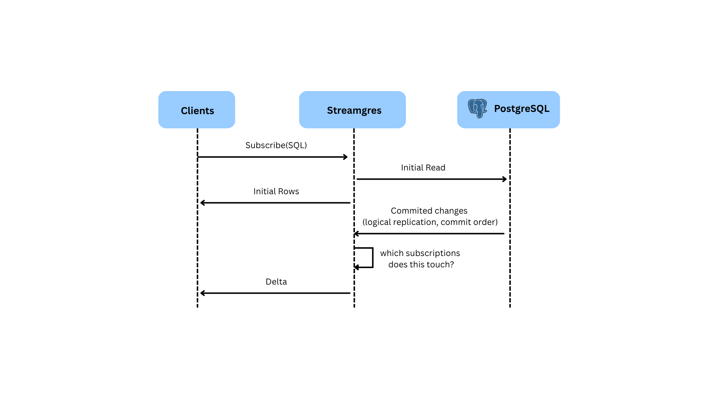
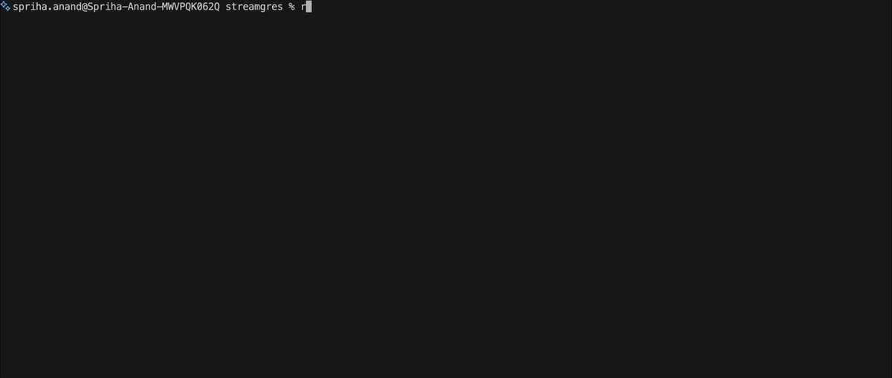
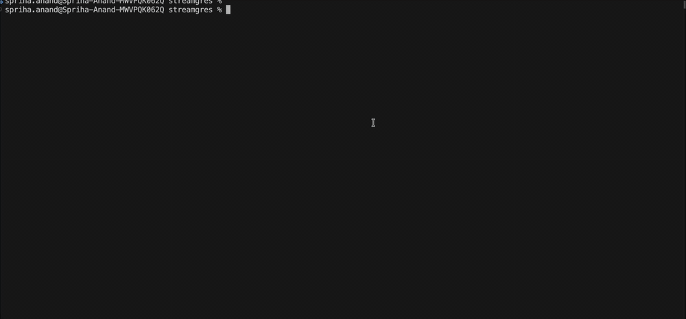
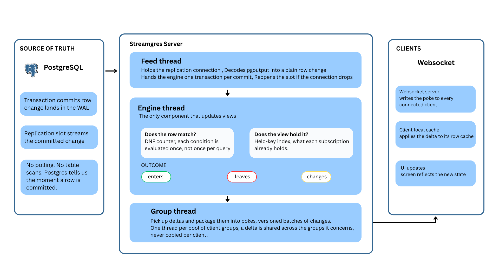

<h1 align="center">Streamgres</h1>

<h3 align="center">Turn PostgreSQL queries into live subscriptions</h3>

<p align="center">
  <a href="LICENSE"></a>
  <a href="https://www.rust-lang.org"></a>
  <a href="https://www.postgresql.org"></a>
</p>

<p align="center">
  <a href="https://github.com/juspay/streamgres"></a>
  <a href="https://github.com/juspay/streamgres/network/members"></a>
  <a href="https://github.com/juspay/streamgres/issues"></a>
  <a href="https://github.com/juspay/streamgres/commits/main"></a>
  <a href="https://github.com/juspay/streamgres/commits/main"></a>
</p>

---

Streamgres is for you if your app often has to poll or repeatedly fetch query results from PostgreSQL to keep screens up to date.

Streamgres lets your clients subscribe to query results and receive rows as they enter, leave, or change (**the delta!**), rather than rerunning the query for every update.

Every subscription is represented as an **incrementally maintained view (IVM)**. Changes are routed only to the views they affect, at a cost that depends on how many conditions the write matches, not on how many subscriptions there are.



## Get Started

### <ins>What you need</ins>

- Rust **1.88+**
- PostgreSQL **16+** with `wal_level = logical` (17+ adds automatic slot cleanup)
- An application server with two endpoints: one turns a query name into a query AST, the other applies mutations




### <ins>Prepare PostgreSQL</ins>

Turn on logical replication:

```sql
wal_level = logical
```

Leave a few free `max_replication_slots` and `max_wal_senders`. Streamgres uses one of each for its change feed.

Then point `STREAMGRES_MASTER_PG_DSN` at a writable superuser connection. On startup Streamgres creates (or checks) its schema, publication and DDL triggers. If something already exists and doesn't match, it refuses to start.

### <ins>Install & Build</ins>

```bash
git clone https://github.com/juspay/streamgres.git
cd streamgres
cp .env.example .env
```


Now edit `.env` :

| Variable | What it is |
| --- | --- |
| `STREAMGRES_PG_DSN` | The database to follow (needs replication + read access) |
| `STREAMGRES_MASTER_PG_DSN` | A writable superuser connection, used for setup |
| `STREAMGRES_QUERY_URL` | Your app server's query endpoint |
| `STREAMGRES_MUTATE_URL` | Your app server's mutate endpoint |

```bash
cargo run --release --bin server
```


### <ins>Run</ins>

The server listens on `0.0.0.0:4848`.

Point your client's `server` option at `http://<host>:4848/sync`. That path is `STREAMGRES_BASE_PATH` from `.env.example`. The client builds the rest of the path itself.

Check it's alive:

```bash
curl localhost:4848/health
```

`503` means the feed is still catching up. `200` means it's serving.

### <ins>Docker</ins>

```bash
docker build -f docker/server/Dockerfile -t streamgres .
docker run --env-file .env -p 4848:4848 streamgres
```

## How it works ?

### <ins>The one-minute version</ins>

PostgreSQL already writes all committed change in its **WAL** (write-ahead log). Streamgres listens to WAL using **logical replication**, the same machinery Postgres uses to keep replicas up to date.

Every subscription your clients hold is kept in memory as a **view**. When a change arrives, Streamgres doesn't re-run any queries. It asks: *which subscriptions care about this row?* , patches exactly those views, and sends each affected client **the delta**: the row that entered, left, or changed.

### <ins>Follow one write, end to end</ins>

Say someone runs `UPDATE tickets SET status = 'CLOSED' WHERE id = 1`:

1. **Postgres commits** and records the change in the WAL. Our replication slot streams it to Streamgres's **feed thread**, which decodes it into a plain row change.
2. The **engine thread** takes the committed change. It's the only component allowed to update views, and it never talks to clients, it only thinks in subscriptions.
3. First question: **does this row match the filter?**
4. Second question: **did the view already hold this row?**

   | Matches filter? | Already held? | Result |
   | --- | --- | --- |
   | Yes | No | The row *enters* |
   | No | Yes | The row *leaves* |
   | Yes | Yes | The row *changes in place* |
5. The engine emits one delta per row, tagged with the subscriptions that care.
6. **Group threads** (one per pool of client groups) pick those up and package them into **pokes** , versioned batches of changes.
7. The **WebSocket server** writes the poke to every connected client. The client's local cache applies it, and the UI updates.

One round trip through the machine, and nobody re-ran a SQL query.

### <ins>Who does what? (the thread model)</ins>

| Thread | Job |
| --- | --- |
| **Feed** | Decodes Postgres's logical replication stream, one transaction per commit |
| **Engine** | Updates views, emits deltas. Single-threaded. |
| **Reads pool** | Runs SQL for initial results and refills |
| **Group threads** | Keep each client group's rows, assemble pokes |
| **WebSocket server** | Connections, protocol, talking to your app server |

A "**client group**" is all the tabs of one user session. Its state (and a log of recent pokes) outlives the last tab for a while, so a quick refresh or reconnect is caught up from what changed, no full re-download.


### <ins>Speaking Zero</ins>

Streamgres implements sync protocol **v51**, the wire protocol of `@rocicorp/zero` 1.9, an unmodified Zero client can point at Streamgres instead of zero-cache. On the wire a delta is just `put` (a row entering or changing, one upsert) or `del` (a row leaving), batched in pokes. Your app server stays in charge of application logic: Streamgres calls its **query endpoint** to turn named queries into query plans, and its **mutate endpoint** to apply writes.


## Features

### <ins>Live data, the easy way</ins>

- **Deltas, not re-runs.** Clients subscribe to a query's results and receive only what changed, a row entered, left, or updated in place.
- **Constant write cost.** Filters are indexed per column, so a write only touches the subscriptions whose conditions it actually matches. 100 or 10,000 subscribers, the write path does the same work.
- **Identical queries share everything.** Subscriptions to the same query share one view and one copy of each row. A new subscriber to a query that's already running is served straight from memory, no database read.
- **Live leaderboards and "top 10" lists.** A "top 10 by score" feed stays live: when a row climbs in or drops out, the client is told exactly which row to add and which to remove, you never re-send the whole list.
- **Live joins.** Feeds built from more than one table (say, tickets *with* their latest comment) stay correct as rows change on either side. And if a query would have to read too much data, Streamgres refuses just that query with a clear error instead of slowing down everyone else's.

### <ins>Kind to your PostgreSQL</ins>

- **Read-only feed.** After a one time setup (publication + DDL triggers, done for you at startup), the change feed only *reads*, it follows a primary, a logical replica, or a physical standby without writing to your tables.
- **Live schema changes.** New tables and new columns with a constant default are picked up while running. Anything bigger stops the server with a message naming the change, restart, and it serves the new schema.
- **No time travel.** Every read happens at a snapshot no newer than the engine's WAL position, and writes committed during the read are replayed before the result lands. A client can see slightly stale data, never a row going backwards.

### <ins>Ready for the real world</ins>

- **Speaks Zero.** An unmodified `@rocicorp/zero` 1.9 client (sync protocol v51) connects as is. Queries and mutations stay with your app server, where your business logic lives.
- **Observability included.** Prometheus metrics, JSON stats, and OTLP push (via opt-in admin endpoints), plus structured logs.
- **Operable from day one.** Health/readiness probes, graceful shutdown, and a slim Docker image.

## Use cases, examples and demos

<!-- Scenarios, examples, demos -->


## Contributors, contact and support

Contributions are welcome.
Let's make Streamgres better together!
<br>
See [CONTRIBUTING.md](CONTRIBUTING.md) for setup, CI checks and the code
conventions.

## License

Licensed under the [Apache License, Version 2.0](LICENSE).
